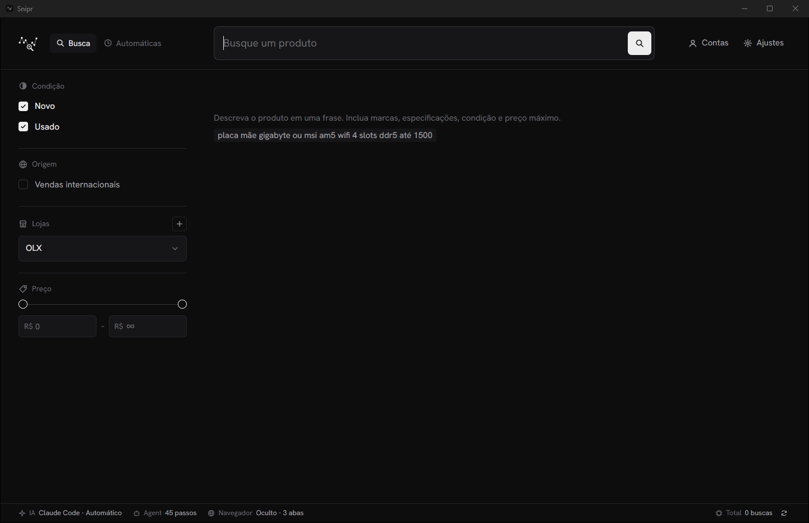

# Snipr



O Snipr é um caçador de preços com IA. Ele é um app desktop para Windows,
macOS e Linux.

Você digita um produto, por exemplo "cadeira DT3 N10 XL". O Snipr procura o
produto em várias lojas ao mesmo tempo. Depois, ele mostra uma lista ordenada
por preço. A lista separa produtos novos e usados.

Lojas incluídas: Mercado Livre, OLX, Facebook Marketplace, Amazon, KaBuM!,
Terabyte, Pichau, Enjoei, Magazine Luiza e Shopee. Você também pode adicionar
outras lojas.

## Princípios

- **Leitura leve.** O Snipr lê cada loja pelo método mais leve que funciona.
  Ele usa HTTP quando possível. Ele abre o Chrome só quando a loja exige um
  navegador.
- **Pouco uso de IA.** A IA não navega nas lojas. Ela faz duas tarefas curtas:
  montar o plano de busca e filtrar os anúncios.
- **App nativo.** O Snipr usa Rust e Tauri. A interface usa a webview do
  sistema. O Snipr não usa Electron.

## Instalação

### Pré-requisitos

- [Rust](https://rustup.rs) (versão stable).
- [Node.js](https://nodejs.org) 22 ou mais recente. O build compila a
  interface em `ui/`.
- Um navegador baseado no Chromium: Google Chrome (recomendado), Chromium,
  Microsoft Edge ou Brave. Sem navegador, o Snipr lê só as lojas das etapas A
  e B.
- Um compilador C. O Rust também exige um compilador C:
  - Windows: Visual Studio Build Tools.
  - macOS: Xcode Command Line Tools.
  - Linux: `build-essential`.
- Linux: as dependências do Tauri (`libwebkit2gtk-4.1-dev`, `libgtk-3-dev`,
  `libayatana-appindicator3-dev`, `librsvg2-dev`) e `libdbus-1-dev` (para o
  cofre de segredos).
- Para o login com uma conta de IA: o CLI do provedor. Veja
  [Provedores de IA](#provedores-de-ia).

### Compilar e executar

1. Clone o repositório.
2. Execute este comando na pasta do projeto:

   ```sh
   cargo run -p snipr-desktop --release
   ```

3. Abra **Ajustes** e configure a IA.

O primeiro build executa `npm ci` e `npm run build` em `ui/`. Para compilar só
o Rust (por exemplo, no CI), defina `SNIPR_SKIP_UI_BUILD=1`.

## Provedores de IA

Configure a IA em **Ajustes > IA**. O Snipr tem três formas de conexão:

| Forma | Provedores | Funcionamento |
|---|---|---|
| **Login** (padrão) | Anthropic, OpenAI, Google | O Snipr usa a conta do CLI oficial: [Claude Code](https://claude.com/claude-code) (`claude`), [Codex](https://developers.openai.com/codex/cli) (`codex`) ou [Antigravity CLI](https://antigravity.google/docs/cli) (`agy`). O botão **Entrar** abre o login do CLI num terminal. |
| **API key** | Anthropic, OpenAI, Google Gemini, xAI, OpenRouter, Ollama (local) e endpoints compatíveis com OpenAI | O Snipr faz chamadas HTTP diretas. A lista de modelos vem da API do provedor. |
| **OAuth** | Anthropic | O Snipr usa o token de `claude setup-token`. |

### Modelos

O Snipr usa dois modelos. Configure os dois em **Ajustes > IA**.

- **Modelo principal.** Ele opera o agent nas lojas que o Snipr não lê
  sozinho. Ele também repete o filtro quando o modelo de busca responde num
  formato incorreto.
- **Modelo de busca.** Ele monta o plano de busca e filtra os anúncios. Estas
  tarefas são curtas e a resposta é em JSON.

Na opção **Automático**, o modelo de busca é o mais novo da família pequena do
provedor:

| Provedor | Modelo de busca automático |
|---|---|
| Anthropic | Haiku (no login do Claude Code, o apelido `haiku`) |
| OpenAI | mini |
| Google | Flash |
| xAI | fast ou mini |
| Codex, Antigravity, Ollama, endpoint personalizado | O modelo principal |

O nome da família pequena muda pouco. Por isso, a escolha automática não usa
uma lista fixa de modelos.

Os campos de modelo e de reasoning mostram só as opções do provedor
selecionado. No login, a lista de modelos vem do CLI: `codex debug models` e
`agy models`. No Claude Code, a lista tem os apelidos `opus`, `sonnet` e
`haiku`.

Para comparar dois modelos, faça a mesma busca com cada modelo. Depois,
compare os anúncios encontrados.

### Login e OAuth: como o CLI funciona

- O Snipr executa o CLI em modo não interativo.
- O Snipr dá as ferramentas do navegador ao CLI por um servidor **MCP** local
  (`127.0.0.1`, com token).
- O Snipr desliga as ferramentas embutidas do CLI (shell, arquivos, web).
- Antigravity CLI: o Snipr adiciona a regra `mcp(snipr/*)` em
  `~/.gemini/antigravity-cli/settings.json`. Sem esta regra, o modo headless
  bloqueia as ferramentas do Snipr.

## Funcionamento de uma busca

1. **Plano.** O modelo de busca transforma a frase do usuário num plano. O
   plano tem: produto, alternativas ("gigabyte ou msi"), requisitos,
   condição, preço máximo e termos de busca. A interface mostra o plano.
2. **Leitura das lojas, sem IA.** O Snipr lê cada loja na etapa dela:

   | Etapa | Método de leitura | Exemplos |
   |---|---|---|
   | **A** | HTTP comum | Amazon, KaBuM!, Kalunga, Chipart, lojas Shopify, Nuvemshop, WooCommerce, Magento e Tray |
   | **B** | HTTP com fingerprint TLS/HTTP2 do Chrome ([impit](https://github.com/apify/impit)) | Terabyte, OLX |
   | **C** | Etapa B com os cookies que o Chrome recebe na proteção anti-bot | Magazine Luiza |
   | **D** | O Chrome abre a busca e o Snipr lê os cards | Mercado Livre, Enjoei, Facebook, Shopee, Pichau |

   Lojas VTEX (Americanas, Fast Shop, Acer) são lidas pela API pública de
   catálogo da plataforma. Páginas com os produtos num JSON embutido (por
   exemplo, `__NEXT_DATA__`) também são lidas por HTTP.
3. **Filtro.** Primeiro, filtros locais removem cards por preço, por palavras
   do plano e por repetição. Depois, a IA recebe os cards de um grupo de
   lojas numa chamada curta. A IA devolve os ids dos anúncios que atendem ao
   plano, com a condição de cada um. Para um anúncio duvidoso, o Snipr abre a
   página do anúncio e expande as especificações. Depois, a IA analisa o
   anúncio de novo.
4. **Agent.** O agent opera só nas lojas sem busca conhecida. A IA controla o
   Chrome com ferramentas e registra os anúncios pelo id do card. O agent tem
   um limite de passos.
5. **PIX, parcelas e cupons, sem IA.** O Snipr lê o texto de cada card. Ele
   também lê por HTTP a página dos 10 anúncios aceitos mais baratos
   (`offers.rs`). Nas lojas da etapa D, ele lê a página do anúncio pela etapa
   B. As regras são iguais para todas as lojas. Exemplos de textos que o
   Snipr reconhece: "10x de R$ 99 sem juros", "R$ 899 no Pix", "Cupom BORA5",
   "5% OFF", cashback.

   O resultado mostra as colunas PIX, Cartão e Informação. A coluna
   Informação aparece só quando um anúncio tem oferta. Para desligar esta
   leitura, use **Ajustes > Resultados**.

### Buscas automáticas

A aba **Automáticas** repete uma busca nas lojas selecionadas. A busca repete
a cada X minutos (mínimo de 5 minutos) ou uma vez por dia, num horário fixo.

- O app precisa estar aberto.
- Se o app estava fechado no horário, a busca começa quando o app abre.
- O Snipr faz uma busca automática de cada vez.
- O botão de parar da busca manual não para as buscas automáticas.

Para usar poucos tokens, a primeira execução salva o plano e as decisões da
IA. Nas execuções seguintes, a IA recebe só os anúncios novos. Se não há
anúncios novos, a execução não usa a IA. Se você muda a frase, a condição ou
o preço máximo, o Snipr apaga os dados salvos.

### Verificação de lojas

O Snipr verifica uma loja quando você adiciona a loja. Para verificar de novo,
use **Lojas > Verificar lojas**. A verificação tem três passos:

1. O Snipr abre a página inicial sem cookies. Ele identifica se a loja exige
   login.
2. O Snipr procura a URL de busca. Ele usa o formulário da página, digita no
   campo de busca e testa caminhos conhecidos da plataforma. A URL é válida
   só se a página mostra resultados da palavra pesquisada.
3. O Snipr lê esta busca no Chrome como referência. Depois, ele testa as
   etapas A, B e C. O Snipr seleciona a etapa mais leve que lê no mínimo 70%
   dos anúncios da referência.

O Snipr salva a etapa nos ajustes. Se a etapa falha durante uma busca
(bloqueio ou página sem cards), o Snipr usa a etapa seguinte e salva esta
etapa. Uma vez por dia, o Snipr testa de novo a etapa mais leve.

### Segredos

O Snipr salva os segredos (tokens e API keys) no cofre do sistema:
Credential Manager (Windows), Keychain (macOS) ou Secret Service (Linux). A
interface pode salvar, trocar ou remover um segredo. A interface não pode ler
um segredo.

Você também pode usar um arquivo `.env`. Veja o modelo em `.env.example`.

## Arquitetura

```
crates/
  snipr-browser   CDP próprio, Chrome real, isolated worlds, input humano, anti-desafio, abas reutilizadas
  snipr-llm       ChatSession: Anthropic (HTTP), compatível com OpenAI
  snipr-core      Engine (orquestrador), busca (search.rs), etapas HTTP (fetch.rs, parse.rs),
                  verificação de lojas (stage.rs), modelos (models.rs), CLIs de IA, ferramentas,
                  servidor MCP, lojas, cofre, ajustes
apps/
  desktop         Tauri: ponte simples entre a interface e o Engine
ui/               TypeScript + Vite, sem framework. Os tipos em ui/src/bindings são gerados do Rust
```

O `Engine` não depende da interface. Você pode chamar o `Engine` de qualquer
thread. Uma nova integração (Telegram, Discord, WhatsApp, API) precisa de só
duas coisas:

1. Chamar `Engine::start_search(SearchRequest, sink)`.
2. Ler o fluxo de `SearchEvent`. Cada evento pode ser serializado em JSON.

O arquivo `crates/snipr-core/examples/search.rs` é um exemplo completo de
interface de linha de comando.

### Navegador e anti-bot

- **Navegadores compatíveis.** Chrome, Chromium, Edge e Brave, no Windows, no
  macOS e no Linux. Todos usam o mesmo protocolo (CDP). Em
  **Ajustes > Navegador**, o Snipr mostra os navegadores encontrados e testa
  o navegador selecionado.
  - O Brave muda o fingerprint de forma aleatória. Alguns sistemas anti-bot
    bloqueiam este comportamento.
  - No Linux, as versões Snap e Flatpak podem não ter acesso à pasta do
    perfil do Snipr.
- **Um processo do Chrome.** O Chrome tem um perfil próprio e permanente. O
  Snipr abre o Chrome só quando uma loja precisa dele (etapas C e D, agent).
- **Abas reutilizadas.** Depois de usar uma aba, o Snipr muda a aba para
  `about:blank`. A aba fica aberta para o próximo uso. Uma página de loja
  aberta continua a executar scripts: ~55% de CPU com 4 abas (medido no
  macOS). Em `about:blank`, o uso cai para ~0,1%.
- **Fechamento automático.** O Chrome fecha após 30 minutos sem uso. Você
  pode mudar este tempo.
- **Modo oculto (padrão).** O Chrome abre uma janela real fora da tela. Não
  há sinal de headless.
- **Sem sinais de automação.** O Snipr não usa `Runtime.enable` nem
  `--enable-automation`. O valor de `navigator.webdriver` é falso. Os
  scripts do agent executam num *isolated world*. A página não vê estes
  scripts.
- **Mouse e teclado.** O Snipr envia os eventos por `Input.dispatch*`. O site
  recebe os eventos como `isTrusted`. Os movimentos do mouse fazem curvas e
  o ritmo do teclado varia.
- **Desafios.** O Snipr espera a verificação automática do Cloudflare. Se o
  Turnstile aparece, o Snipr clica nele. Se o desafio continua, o Snipr
  mostra a janela e pede ajuda.
- **Bloqueios.** Para um bloqueio 403 ou 429 (por exemplo, Akamai), o Snipr
  espera e tenta de novo. Se o bloqueio continua, o Snipr pula a loja e
  mostra um aviso.
- **CPU antes de RAM.** O Snipr usa mais RAM para usar menos CPU: abas e
  Chrome ficam abertos e a GPU faz a composição. O Snipr bloqueia imagens,
  fontes, mídia e redes de anúncio e rastreamento.
- **Flags que não devem ser usadas.** `--disable-gpu` e
  `--disable-site-isolation-trials` diminuem o uso de RAM, mas mostram a
  automação. Com `--disable-gpu`, o WebGL mostra "Microsoft Basic Render
  Driver". Com `--disable-site-isolation-trials`, o sensor do Akamai bloqueia
  o acesso.

### Login nas lojas

- **Contas > Entrar** abre a loja numa janela visível. Faça o login uma vez
  (2FA incluído). O Snipr salva a sessão no perfil.
- Se uma loja pede login durante uma busca, o Snipr mostra a janela. Faça o
  login na janela. O agent nunca digita senhas.
- Quando você adiciona uma loja (**Lojas > +**), o Snipr verifica a loja.
  Veja [Verificação de lojas](#verificação-de-lojas).

### Textos da interface

Os textos da interface usam um português técnico simplificado, baseado no
ASD-STE100. Este README usa as mesmas regras. Veja
[docs/escrita.md](docs/escrita.md).

## Desenvolvimento

```sh
cargo clippy --workspace                  # lint
cargo test --workspace                    # testes rápidos
cargo test -p snipr-core -- --ignored     # ponta a ponta: Chrome real + MCP + CLIs de IA (usa a IA)
SNIPR_TEST_SITES=kabum,dt3 cargo test -p snipr-core --release verifica_lojas -- --ignored --nocapture
                                          # verifica lojas reais (Chrome + internet, sem IA)
                                          # SNIPR_TEST_PROFILE = pasta do perfil
cargo test -p snipr-core export_bindings  # gera de novo os tipos TypeScript em ui/src/bindings
npm --prefix ui run check                 # verifica os tipos da interface
```

### Ferramentas de diagnóstico

Estas ferramentas não usam a IA, exceto onde indicado.

| Comando | Função |
|---|---|
| `cargo run -p snipr-browser --example probe --release -- "<url>" [hidden\|headless\|visible]` | Abre a URL. Mostra desafios, sinais de automação, cards (preço, preço riscado, título, link) e um snapshot. |
| `cargo run -p snipr-browser --example debug --release -- "<url>" "<js>" ...` | Executa expressões JS no isolated world da página. |
| `cargo run -p snipr-browser --example ram --release` | Mede a RAM do Chrome com 4 abas em paralelo (Windows). |
| `cargo run -p snipr-browser --example webgl --release` | Mostra os dados de WebGL que os sites recebem. |
| `cargo run -p snipr-core --example search -- "<produto>" site1,site2` | Faz uma busca completa pelo `Engine`, com o provedor e os segredos configurados. **Usa a IA.** |
| `cargo run -p snipr-core --example plan -- "<frase>" [login\|api_key\|oauth] [provedor]` | Mostra o plano de busca da IA. Não abre o navegador. **Usa a IA.** |

### Variáveis de ambiente do Chrome

- `SNIPR_CHROME_ARGS="--flag1 --flag2"`: adiciona flags.
- `SNIPR_CHROME_BARE=1`: remove todas as flags opcionais. Use para isolar a
  flag que causa uma detecção.

### Arquivos do app

| Arquivo | Windows | Outros sistemas |
|---|---|---|
| Ajustes | `%APPDATA%\snipr\settings.json` | `dirs::config_dir()/snipr` |
| Histórico (uma linha JSON por busca; ligue em Ajustes) | `%APPDATA%\snipr\history\manual.jsonl` e `auto.jsonl` | `dirs::config_dir()/snipr` |
| Buscas automáticas | `%APPDATA%\snipr\schedules.json`; última execução e decisões da IA em `auto\` | `dirs::config_dir()/snipr` |
| Anúncios abertos | `%APPDATA%\snipr\visited.json` | `dirs::config_dir()/snipr` |
| Perfil do Chrome | `%LOCALAPPDATA%\snipr\chrome-profile` | `dirs::data_local_dir()/snipr` |
| Log de erros fatais | `%LOCALAPPDATA%\snipr\crash.log` | `dirs::data_local_dir()/snipr` |

## Aviso

Use o Snipr de forma responsável. Obedeça aos termos de uso de cada loja e do
provedor de IA.

## Licença

O Snipr usa a licença [GNU GPL v3](LICENSE).
